<!-- Banner (animated SVG) -->

  

  
  
  

## About me

🇻🇳 Mình là **Phạm Văn Đức**, sinh viên năm cuối Kỹ thuật Phần mềm tại **Đại học FPT TP.HCM**, giảng viên lập trình tại **MindX** và freelance developer. Mình đang tìm cơ hội **Backend / Full-stack Developer**.

🇬🇧 I'm a final-year Software Engineering student at **FPT University (Ho Chi Minh City)**, a programming instructor at **MindX** and a freelance developer, looking for a **Backend / Full-stack Developer** role.

- I build backends with **Java 17, Spring Boot 3, PostgreSQL** and ship them with **Docker**
- I build frontends with **React + TypeScript** to deliver features end-to-end
- I freelance on web systems for SMEs and teach programming at **MindX**
- I'm interested in system design and AI-integrated products, and I use AI coding agents in my daily workflow

## Tech stack

**Backend**

  
  
  
  
  
  

**Frontend**

  
  
  
  
  
  

**Data, DevOps & AI**

  
  
  
  
  
  
  

## Featured projects

| Project | What it is | Stack |
| --- | --- | --- |
| **[Viway Fitness Pro](https://github.com/Ducpham04/Nura_Fitness_Pro-ct)** · [live](https://app.viway.id.vn/) | AI fitness & nutrition platform: personalized workout and meal plans, challenges, rewards. 250+ REST endpoints, 37-table schema, 4 Dockerized services | Spring Boot 3 · PostgreSQL · Flyway · JWT · FastAPI (LLM) · React · Docker |
| **[Real Estate Management](https://github.com/Ducpham04/realestate-management)** | _Coming soon_ — property listing & management system | Spring Boot · MySQL · React |
| **[Spring Boot Starter](https://github.com/Ducpham04/springboot-starter)** | _Coming soon_ — reusable Spring Boot template: auth, layered architecture, Docker | Spring Boot 3 · Spring Security · JWT · Docker |
| **[Portfolio](https://github.com/Ducpham04/portfolio)** | _Coming soon_ — personal portfolio website | React · TypeScript · Tailwind CSS |

## GitHub stats

  
  

---

Open to Backend / Full-stack roles in Ho Chi Minh City — feel free to reach out.

