<!-- Banner (animated SVG) -->

  

  
  
  
  

## 👋 About me

🇻🇳 Mình là **Phạm Văn Đức**, sinh viên năm cuối Kỹ thuật Phần mềm tại **Đại học FPT TP.HCM**, giảng viên lập trình tại **MindX** và freelance developer. Mình đang tìm cơ hội **Web Developer / Full-stack Developer**.

🇬🇧 I'm a final-year Software Engineering student at **FPT University (Ho Chi Minh City)**, a programming instructor at **MindX** and a freelance developer, looking for a **Web Developer / Full-stack Developer** role.

  

- I build responsive websites and web apps with **HTML, CSS, JavaScript, React + TypeScript** and Tailwind CSS
- I build the APIs behind them with **Java, Spring Boot 3, PostgreSQL / MySQL** and deploy with **Docker** and Vercel
- I freelance on web systems for SMEs and teach programming at **MindX**
- I'm interested in fast, accessible websites and AI-integrated products

## 🛠 Tech stack

  <b>Backend</b>  
  

  <b>Frontend</b>  
  

  <b>Data · DevOps · Tools</b>  
  

  
  
  

## 🚀 Featured projects

| Project | What it is | Stack |
| --- | --- | --- |
| **[Viway Fitness Pro](https://github.com/Ducpham04/Nura_Fitness_Pro-ct)** · [live](https://app.viway.id.vn/) | AI fitness & nutrition platform: personalized workout and meal plans, challenges, rewards. 250+ REST endpoints, 37-table schema, 4 Dockerized services | Spring Boot 3 · PostgreSQL · Flyway · JWT · FastAPI (LLM) · React · Docker |
| **[Landing Templates](https://github.com/Ducpham04/landing-templates)** | 3 responsive landing pages (real estate, interior design, education), each with its own visual style; prerendered at build time for fast loads and SEO | React 19 · TypeScript · Vite · Tailwind CSS v4 · Framer Motion |
| **[Real Estate Management](https://github.com/Ducpham04/realestate-management)** | Property, client, viewing and deal management with a revenue dashboard; ADMIN / AGENT roles, rotating JWT refresh tokens, one-command `docker compose up` | Spring Boot 3.5 · MySQL · Flyway · React · TanStack Query · Testcontainers |
| **[Spring Boot Starter](https://github.com/Ducpham04/springboot-starter)** | Reusable backend template for client management systems: JWT auth, roles, standard responses, dynamic filtering, file upload, Docker, CI | Spring Boot 3.5 · Spring Security · MySQL · Flyway · JUnit 5 |
| **[English Learning Platform](https://github.com/Ducpham04/English-LearningAppDesign)** | Student / Teacher / Admin learning platform with pronunciation scoring, auto transcripts and AI conversation | Spring Boot · React · PostgreSQL · AWS S3 · Azure Speech · OpenAI |

## 📊 GitHub stats

  
  

  

  

  <picture>
    <source media="(prefers-color-scheme: dark)" srcset="https://raw.githubusercontent.com/Ducpham04/Ducpham04/output/github-snake-dark.svg"/>
    
  </picture>

Open to Web Developer / Full-stack roles in Ho Chi Minh City — feel free to reach out.

