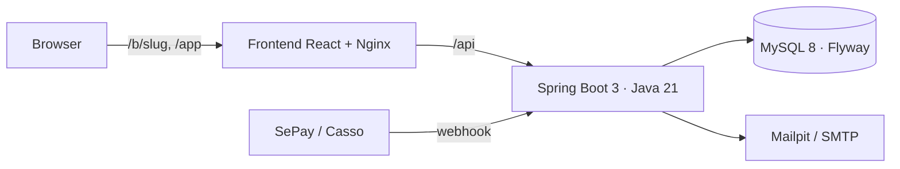

# BookEasy

SaaS đặt lịch cho **spa, salon, phòng gym và phòng khám nhỏ** ở Việt Nam. Mỗi cơ sở có một trang đặt lịch công khai `/b/{slug}`: khách chọn dịch vụ, nhân viên, giờ trống thật, rồi đặt cọc qua VietQR. Chủ cơ sở quản lý toàn bộ lịch trên một màn hình.

> Trạng thái: MVP, xem [docs/FINAL_REPORT.md](docs/FINAL_REPORT.md) và [docs/CHECKLIST.md](docs/CHECKLIST.md).

## Tính năng
- **Trang đặt lịch công khai** mobile-first, mang logo và màu thương hiệu của cơ sở; tra cứu/hủy bằng mã lịch hẹn + SĐT (không cần tài khoản).
- **Không trùng lịch**: giờ trống tính từ giờ mở cửa ∩ ca nhân viên − ngày nghỉ − nghỉ phép; ràng buộc `UNIQUE` ở DB bảo đảm hai khách không giữ cùng một chỗ.
- **Đặt cọc / trả trước VietQR**, nội dung CK là mã lịch hẹn; webhook SePay, Casso, mock; tự hủy khi quá hạn 30'.
- **Lịch ngày/tuần theo nhân viên**, kéo thả đổi giờ, check-in, hoàn thành, hủy, không đến.
- **Nhắc lịch**: email xác nhận, nhắc trước 24h và 2h; Zalo ZNS (interface + mock).
- **Khách hàng**: lịch sử, số lần đến, no-show, chi tiêu, ghi chú.
- **Báo cáo**: doanh thu, số lịch, tỷ lệ no-show/hủy, dịch vụ và nhân viên bán chạy.
- **Đa cơ sở & phân quyền**: SUPER_ADMIN, OWNER, STAFF; khách (CUSTOMER) không cần tài khoản.

## Kiến trúc

Chi tiết: [ARCHITECTURE.md](docs/ARCHITECTURE.md) (ERD, API, phân quyền) · [DESIGN.md](docs/DESIGN.md) · [PRD.md](docs/PRD.md) · [DECISIONS.md](docs/DECISIONS.md).

## Chạy bằng Docker (một lệnh)
```bash
cd bookeasy
cp .env.example .env
docker compose up --build
```
- Web: http://localhost:3000 · Trang đặt lịch mẫu: http://localhost:3000/b/lotus-spa
- API docs (Swagger): http://localhost:3000/swagger-ui.html
- Hộp thư email dev (Mailpit): http://localhost:8025

> Lưu ý: `docker compose` chưa được chạy thử trong môi trường phát triển (không có Docker). Nếu lỗi, dùng cách chạy dev bên dưới.

## Chạy dev không cần Docker/MySQL
```bash
# Terminal 1 – backend với H2 trong bộ nhớ + dữ liệu demo
cd bookeasy/backend
mvn spring-boot:run -Dspring-boot.run.profiles=h2
```
```bash
# Terminal 2 – frontend (proxy /api sang :8080)
cd bookeasy/frontend
npm install
npm run dev
```
Mở http://localhost:5173.

## Tài khoản demo (mật khẩu `Demo@123`)
| Vai trò | Email |
|---|---|
| Super admin | admin@bookeasy.vn |
| Chủ Lotus Spa | owner@lotusspa.vn |
| Nhân viên Lotus Spa | lan@lotusspa.vn, thu@lotusspa.vn |
| Chủ Titan Fitness | owner@titanfitness.vn |
| Chủ Nha khoa An Tâm | owner@nhakhoaantam.vn |

Trang đặt lịch: `/b/lotus-spa` (đặt cọc 30%), `/b/titan-fitness`, `/b/nha-khoa-an-tam`.

## Kiểm thử
```bash
cd bookeasy/backend && mvn test        # 60 test unit + integration (H2)
```
```bash
cd bookeasy/frontend && npm run lint && npm run build
```
Xem [docs/TEST_PLAN.md](docs/TEST_PLAN.md).

## Tích hợp thanh toán
- **SePay**: tạo webhook trỏ tới `https://<domain>/api/webhooks/payments/sepay`, chọn xác thực API Key = `PAYMENT_WEBHOOK_SECRET` (header `Authorization: Apikey <key>`).
- **Casso**: webhook `https://<domain>/api/webhooks/payments/casso`, khóa bảo mật = `PAYMENT_WEBHOOK_SECRET` (header `Secure-Token`).
- **Thử nghiệm**:
```bash
curl -X POST localhost:8080/api/webhooks/payments/mock -H 'X-Webhook-Secret: dev-webhook-secret' -H 'Content-Type: application/json' -d '{"txnId":"T1","amount":84000,"content":"BEXXXXXX"}'
```

## Deploy production
1. Đặt `JWT_SECRET` ngẫu nhiên ≥ 32 ký tự, `PAYMENT_WEBHOOK_SECRET`, `PAYMENT_MOCK_ENABLED=false`, `APP_SEED_DEMO=false`, `PUBLIC_URL`, `CORS_ORIGINS`.
2. Cấu hình SMTP thật (`MAIL_HOST`, `MAIL_PORT`, `MAIL_USERNAME`, `MAIL_PASSWORD`, `MAIL_SMTP_AUTH=true`, `MAIL_STARTTLS=true`).
3. Dùng MySQL 8 có backup; Flyway tự migrate khi khởi động.
4. Đặt TLS ở reverse proxy/load balancer phía trước service `frontend`.

## Cấu trúc thư mục
```
bookeasy/
├── backend/    Spring Boot API (vn.bookeasy.*), Flyway migrations, tests
├── frontend/   React app (features/public, features/app, features/admin)
├── docs/       PRD, DESIGN, ARCHITECTURE, DECISIONS, CHECKLIST, TEST_PLAN, FINAL_REPORT
└── docker-compose.yml
```
