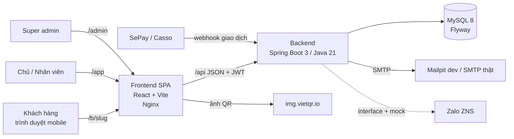
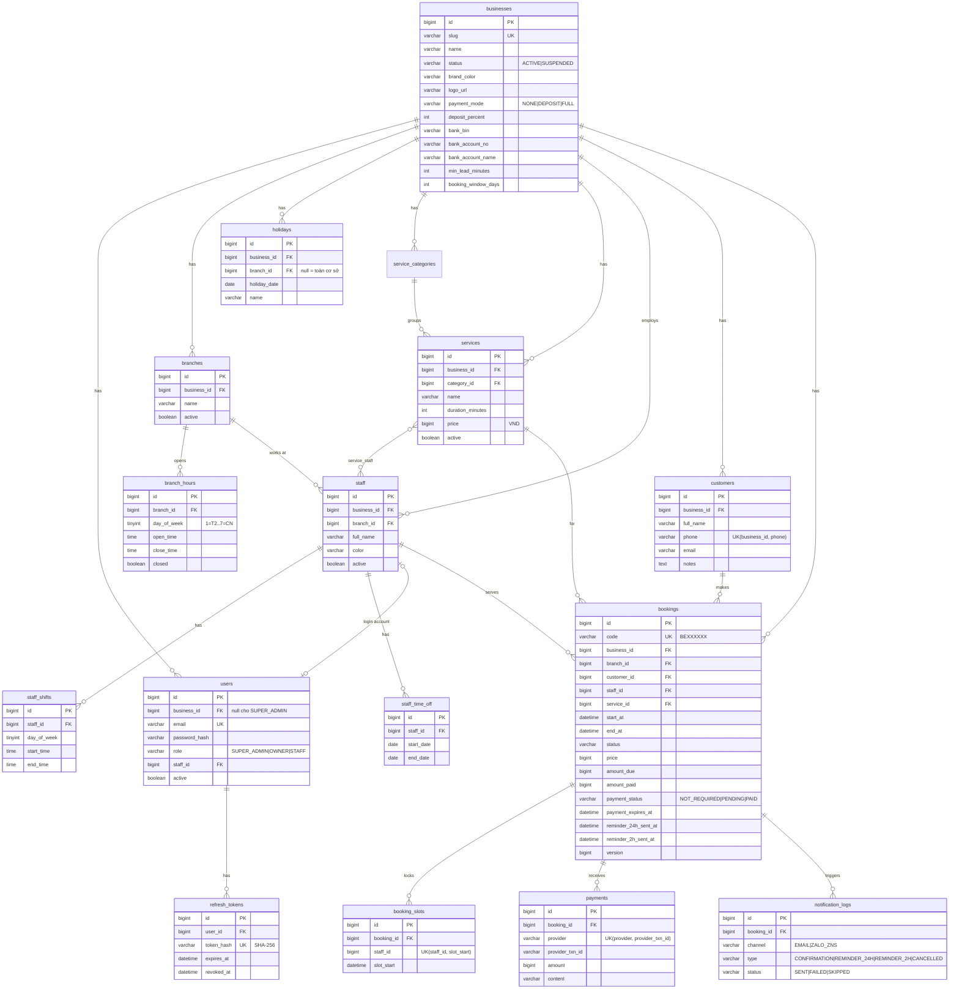
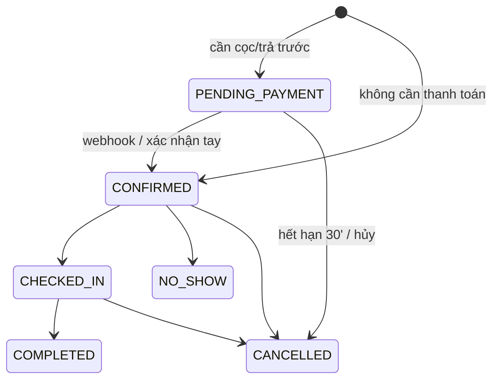

# BookEasy – Kiến trúc giải pháp

## 1. Tổng quan



- **Modular monolith** (một service Spring Boot), chia package theo domain. Đủ cho vài nghìn cơ sở; tách service khi cần.
- **Multi-tenant shared database, shared schema**: mọi bảng nghiệp vụ có `business_id`. `businessId` lấy từ JWT (không bao giờ từ request body); mọi truy vấn repository đều lọc theo `business_id` → truy cập chéo tenant trả 404.
- Frontend SPA build tĩnh, phục vụ bởi Nginx; Nginx reverse-proxy `/api` và `/uploads` sang backend → cùng origin, không cần CORS ở production.
- Múi giờ: MVP cố định `Asia/Ho_Chi_Minh` (VN không có DST). Thời gian lưu `DATETIME` giờ địa phương; `Clock` được inject để test.

## 2. Chống đặt trùng (double booking)

MySQL không có exclusion constraint cho khoảng thời gian, nên dùng **bảng khóa slot**:

- Thời gian chia đơn vị **15 phút**. Booking 60 phút của nhân viên X lúc 09:00 chèn 4 dòng vào `booking_slots(staff_id, slot_start)` = 09:00, 09:15, 09:30, 09:45.
- `UNIQUE(staff_id, slot_start)` → hai giao dịch đồng thời chồng lấn bất kỳ đơn vị nào, chỉ một giao dịch commit thành công; giao dịch kia nhận `DataIntegrityViolationException` → API trả **409**.
- Hủy / hết hạn thanh toán → xóa các dòng slot (giải phóng). Đổi giờ = xóa + chèn trong cùng transaction.
- Kiểm tra mềm (đọc slot trống) chỉ để UX; ràng buộc DB là nguồn sự thật.

## 3. Thuật toán tính slot trống

```
input: service S, branch B, date D, staff (một người hoặc "bất kỳ")
candidates = staff đang hoạt động ở B, làm được S
nếu D là ngày nghỉ (holiday toàn cơ sở hoặc của B) hoặc B đóng cửa ngày D → []
open = giờ mở cửa của B theo thứ của D
for staff in candidates:
   if staff nghỉ (time_off chứa D) → bỏ qua
   windows = (ca của staff theo thứ) ∩ open
   busy = tập slot_start đã khóa của staff trong ngày D (1 truy vấn)
   for t in windows, bước 15 phút, t + duration ≤ cuối window:
       nếu mọi đơn vị [t, t+duration) không thuộc busy và t ≥ now + min_lead → thêm (t, staff)
output: danh sách giờ, mỗi giờ kèm danh sách staffId còn trống
```
Khi đặt "bất kỳ ai": chọn nhân viên trống có ít booking nhất trong ngày; nếu insert slot thất bại thì thử nhân viên kế tiếp.

## 4. ERD



### Vòng đời booking


## 5. API (REST, JSON, tiền tố `/api`)

Swagger UI: `/swagger-ui.html` · OpenAPI: `/v3/api-docs`. Lỗi dạng `{ "status": 409, "code": "SLOT_TAKEN", "message": "...", "fieldErrors": {..} }`.

| Nhóm | Method & đường dẫn | Quyền |
|---|---|---|
| Auth | `POST /auth/register` – đăng ký cơ sở + OWNER | public |
| | `POST /auth/login` · `POST /auth/refresh` · `POST /auth/logout` | public |
| | `GET /auth/me` | đã đăng nhập |
| Công khai | `GET /public/businesses/{slug}` – thông tin, chi nhánh, danh mục, dịch vụ | public |
| | `GET /public/businesses/{slug}/staff?serviceId&branchId` | public |
| | `GET /public/businesses/{slug}/availability?serviceId&branchId&date&staffId?` | public |
| | `GET /public/businesses/{slug}/availability/days?serviceId&branchId&staffId?&from&days` | public |
| | `POST /public/businesses/{slug}/bookings` (rate-limit theo IP) | public |
| | `GET /public/bookings/{code}?phone=` · `POST /public/bookings/{code}/cancel` | public + SĐT |
| Cơ sở | `GET/PUT /business` · `POST /business/logo` | OWNER (GET: OWNER, STAFF) |
| | `GET/POST /branches` · `PUT/DELETE /branches/{id}` · `PUT /branches/{id}/hours` | OWNER |
| | `GET/POST /holidays` · `DELETE /holidays/{id}` | OWNER |
| Dịch vụ | `GET/POST /service-categories` · `PUT/DELETE /service-categories/{id}` | OWNER (GET: + STAFF) |
| | `GET/POST /services` · `GET/PUT/DELETE /services/{id}` | OWNER (GET: + STAFF) |
| Nhân viên | `GET/POST /staff` · `GET/PUT/DELETE /staff/{id}` | OWNER (GET: + STAFF) |
| | `PUT /staff/{id}/shifts` · `GET/POST /staff/{id}/time-off` · `DELETE /staff/{id}/time-off/{offId}` | OWNER |
| | `POST /staff/{id}/account` – tạo tài khoản STAFF | OWNER |
| Booking | `GET /bookings?from&to&staffId&branchId&status&q` | OWNER; STAFF chỉ của mình |
| | `GET /bookings/{id}` · `POST /bookings` · `PATCH /bookings/{id}/reschedule` | OWNER, STAFF(của mình) |
| | `POST /bookings/{id}/status` · `POST /bookings/{id}/mark-paid` | OWNER; STAFF: CHECKED_IN/COMPLETED/NO_SHOW của mình |
| | `GET /dashboard/today` | OWNER, STAFF |
| Khách | `GET /customers?q&page&size` · `GET /customers/{id}` · `PATCH /customers/{id}` | OWNER |
| Báo cáo | `GET /reports/summary?from&to` | OWNER |
| Webhook | `POST /webhooks/payments/{provider}` (header `X-Webhook-Secret` / `Authorization: Apikey`) | secret |
| Admin | `GET /admin/businesses` · `PATCH /admin/businesses/{id}/status` · `GET /admin/stats` | SUPER_ADMIN |

## 6. Bảo mật & phân quyền
- Spring Security stateless; `JwtAuthFilter` đọc `Authorization: Bearer`. Claims: `sub`=userId, `role`, `bid`=businessId, `sid`=staffId.
- Access token 15 phút (HS256, secret ≥ 32 byte từ env `JWT_SECRET`); refresh token ngẫu nhiên 256-bit, lưu **SHA-256** trong DB, xoay vòng mỗi lần refresh, thu hồi khi logout; phát hiện tái sử dụng token đã thu hồi → thu hồi toàn bộ phiên của user.
- `@PreAuthorize` theo role ở controller; kiểm tra tenant + "của mình" (STAFF) ở service.
- Mật khẩu BCrypt(10). Validate bằng Jakarta Validation; JPA chỉ dùng tham số bind (không nối chuỗi SQL).
- Rate limit in-memory (token bucket theo IP) cho tạo booking công khai, tra cứu và login.
- Webhook kiểm tra secret bằng so sánh hằng thời gian; idempotent theo `(provider, provider_txn_id)`.
- Upload logo: kiểm tra MIME + magic bytes, ≤ 2MB, tên file ngẫu nhiên.
- Lỗi trả thông điệp chung, không lộ stacktrace.

## 7. Tích hợp
- **VietQR**: `https://img.vietqr.io/image/{bankBin}-{accountNo}-compact2.png?amount={amount}&addInfo={code}&accountName={name}` (backend dựng URL, frontend chỉ hiển thị).
- **Webhook thanh toán**: interface `PaymentWebhookParser` → `SepayParser`, `CassoParser`, `MockParser`. Chuẩn hóa thành `IncomingTransfer{txnId, amount, content}` → `PaymentService.applyTransfer` (regex `BE[A-Z0-9]{6}`).
- **Thông báo**: interface `NotificationChannel` → `EmailChannel` (JavaMailSender, template HTML tiếng Việt), `ZaloZnsChannel` (mock: ghi log + `notification_logs`). `ReminderScheduler` chạy mỗi phút. `PaymentExpiryScheduler` hủy booking chờ thanh toán quá hạn.

## 8. Cấu trúc thư mục
```
bookeasy/
├── docker-compose.yml          # mysql + mailpit + backend + frontend
├── .env.example
├── docs/                       # PRD, DESIGN, ARCHITECTURE, CHECKLIST, TEST_PLAN, DECISIONS, FINAL_REPORT
├── backend/
│   ├── Dockerfile
│   ├── pom.xml
│   └── src/main/java/vn/bookeasy/
│       ├── BookEasyApplication.java
│       ├── common/             # exception, error handler, rate limit, utils, Clock
│       ├── config/             # security, openapi, web, scheduling
│       ├── auth/               # jwt, refresh token, AuthController
│       ├── business/           # business, branch, hours, holiday
│       ├── catalog/            # service, category
│       ├── staff/              # staff, shifts, time off
│       ├── customer/
│       ├── booking/            # booking, slot lock, availability, status flow
│       ├── payment/            # VietQR, webhook parsers
│       ├── notification/       # channels, scheduler
│       ├── report/
│       ├── admin/
│       └── seed/               # dữ liệu demo tiếng Việt
│   └── src/main/resources/db/migration/   # Flyway V1__...
├── frontend/
│   ├── Dockerfile · nginx.conf
│   └── src/
│       ├── api/                # axios client, hooks React Query
│       ├── components/ui/      # Button, Input, Panel, Badge, Sheet...
│       ├── features/           # public-booking, calendar, bookings, customers, services, staff, reports, settings, admin, auth
│       ├── lib/                # format tiền/ngày, zod schemas
│       └── routes.tsx
└── e2e/                        # Playwright
```
