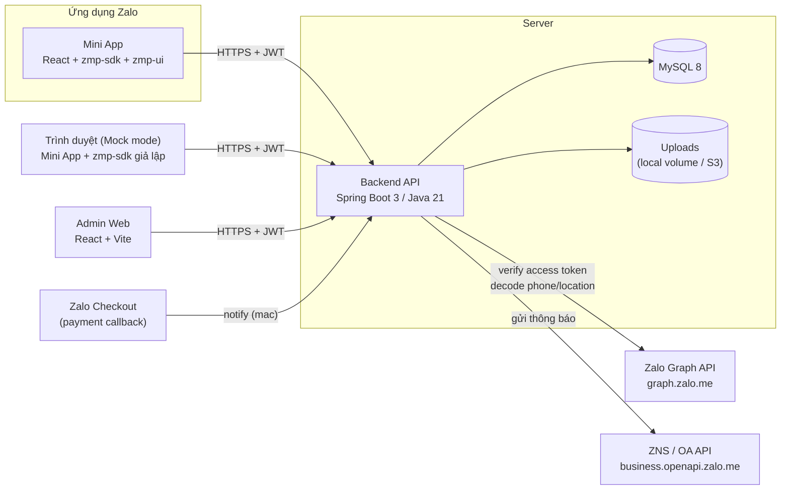
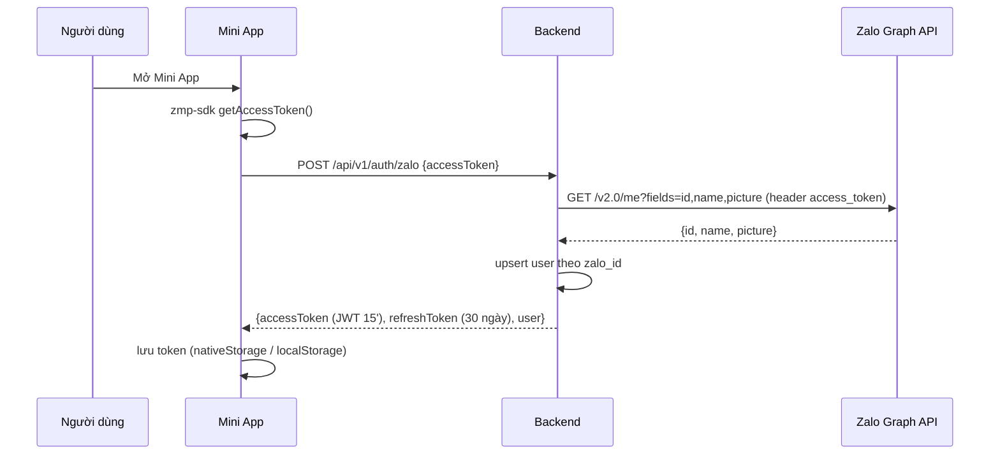
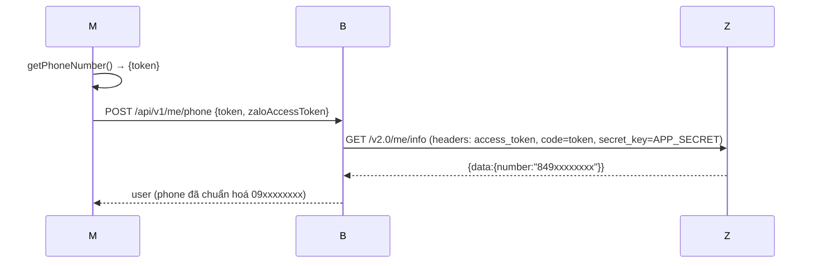
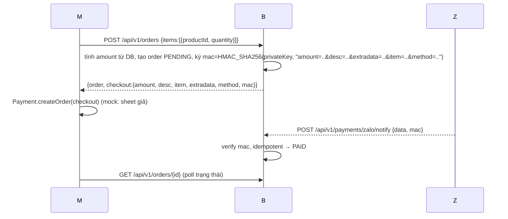
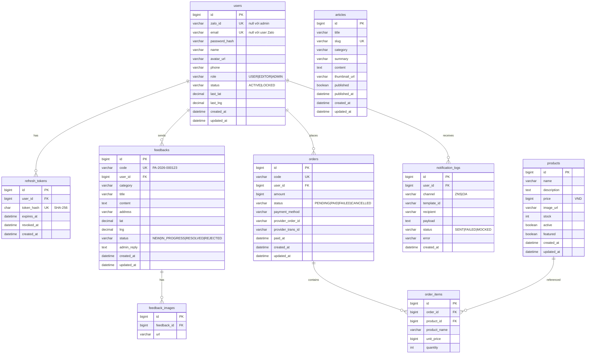

# ARCHITECTURE – Zalo Mini App Starter Kit

> Vai trò: Solution Architect

## 1. Tổng quan



- **Monorepo**: `/miniapp`, `/admin`, `/backend`, `/e2e`, `/docs`, `docker-compose.yml`.
- **Backend** là *modular monolith* chia theo tính năng (package-by-feature), mỗi tích hợp bên ngoài nằm sau một **interface + 2 implementation (mock / real)** chọn bằng cấu hình:

| Interface | Mock | Real | Thuộc tính |
|-----------|------|------|-----------|
| `ZaloGraphClient` | `MockZaloGraphClient` | `HttpZaloGraphClient` | `app.zalo.mock` |
| `NotificationGateway` | `MockNotificationGateway` | `ZnsNotificationGateway` | `app.notification.provider=mock|zns` |
| `PaymentProvider` | `MockPaymentProvider` | `ZaloCheckoutPaymentProvider` | `app.payment.provider=mock|zalo` |
| `StorageService` | – | `LocalStorageService` (S3 sau MVP) | `app.storage.*` |

- **Mini App**: mọi lời gọi zmp-sdk đi qua `src/zalo/bridge.ts` (interface `ZaloBridge`), có `realBridge` (import động `zmp-sdk/apis`) và `mockBridge`. Chọn theo `VITE_ZALO_MODE`.

## 2. Luồng chính

### 2.1 Đăng nhập Zalo


### 2.2 Số điện thoại / vị trí (token → backend giải mã)

> `secret_key` (App Secret) **chỉ nằm ở backend**. Zalo access token được Mini App gửi kèm vì backend không lưu token Zalo.

### 2.3 Refresh token (client)
1 request 401 `TOKEN_EXPIRED` → lớp API khoá "refreshing" (single-flight promise), các request khác chờ → gọi `/auth/refresh` → phát lại. Refresh lỗi → `logout()` + đăng nhập lại.

### 2.4 Thanh toán Checkout SDK


## 3. ERD



## 4. API (prefix `/api/v1`, JSON, OpenAPI tại `/swagger-ui.html`)

| Method | Path | Quyền | Mô tả |
|--------|------|-------|-------|
| POST | `/auth/zalo` | public | Đăng nhập bằng Zalo access token |
| POST | `/auth/login` | public | Đăng nhập admin (email/mật khẩu) |
| POST | `/auth/refresh` | public | Đổi refresh token lấy cặp token mới |
| POST | `/auth/logout` | public | Thu hồi refresh token |
| GET | `/me` | auth | Thông tin tài khoản |
| PATCH | `/me` | auth | Sửa tên hiển thị |
| POST | `/me/phone` | USER | Giải mã token SĐT |
| POST | `/me/location` | USER | Giải mã token vị trí |
| GET | `/articles` | public | `?q=&category=&page=&size=` |
| GET | `/articles/{id}` | public | Chỉ tin đã xuất bản |
| GET | `/articles/categories` | public | Danh sách chuyên mục |
| GET | `/products` | public | `?q=&featured=&page=&size=` |
| GET | `/products/{id}` | public | |
| POST | `/feedbacks` | USER | multipart: `data` (JSON) + `images[]` |
| GET | `/feedbacks/me` | USER | Lịch sử phản ánh của tôi |
| GET | `/feedbacks/{id}` | owner/ADMIN | Chi tiết |
| GET | `/feedbacks/categories` | public | Chuyên mục phản ánh |
| POST | `/orders` | USER | Tạo đơn + tham số checkout |
| GET | `/orders/me` | USER | Đơn của tôi |
| GET | `/orders/{id}` | owner/ADMIN | |
| POST | `/orders/{id}/mock-pay` | owner (chỉ khi provider=mock) | Giả lập thanh toán |
| POST | `/payments/zalo/notify` | public (xác minh mac) | Callback Checkout |
| POST | `/uploads` | EDITOR+ | Upload ảnh cho nội dung admin |
| GET | `/admin/stats` | EDITOR+ | Số liệu dashboard |
| GET/POST/PUT/DELETE | `/admin/articles[/{id}]` | EDITOR+ | CRUD tin |
| GET/POST/PUT/DELETE | `/admin/products[/{id}]` | EDITOR+ | CRUD sản phẩm |
| GET | `/admin/feedbacks` | ADMIN | `?status=&q=` |
| GET | `/admin/feedbacks/{id}` | ADMIN | |
| PATCH | `/admin/feedbacks/{id}` | ADMIN | `{status, adminReply}` → gửi thông báo |
| GET | `/admin/users` | ADMIN | |
| GET | `/admin/orders` | ADMIN | |
| GET | `/admin/notifications` | ADMIN | Nhật ký thông báo |
| GET | `/public/config` | public | Cờ cấu hình cho client (mock mode, payment provider) |

**Định dạng lỗi** thống nhất:
```json
{ "status": 400, "code": "VALIDATION_ERROR", "message": "Dữ liệu không hợp lệ", "errors": {"title": "Tiêu đề phải từ 5–150 ký tự"}, "path": "/api/v1/feedbacks", "timestamp": "..." }
```
**Phân trang**: `{ "items": [...], "page": 0, "size": 10, "totalElements": 42, "totalPages": 5 }`.

## 5. Phân quyền

| Vai trò | Mini App | Nội dung (tin/SP) | Phản ánh (admin) | Người dùng/Đơn/Thông báo |
|---------|----------|-------------------|------------------|--------------------------|
| `USER` | ✅ | đọc | chỉ của mình | ❌ |
| `EDITOR` | – | ✅ CRUD | ❌ | ❌ |
| `ADMIN` | – | ✅ CRUD | ✅ | ✅ |

Thực thi bằng `SecurityFilterChain` (theo path) + `@PreAuthorize` + kiểm tra *ownership* trong service.

## 6. Bảo mật
- JWT HS256, secret ≥ 256 bit lấy từ `APP_JWT_SECRET`; access 15', refresh 30 ngày, refresh lưu **SHA-256 hash**, rotation + thu hồi.
- BCrypt (strength 10) cho mật khẩu admin.
- Bean Validation cho mọi input; JPA tham số hoá (không nối chuỗi SQL); `LIKE` escape ký tự đặc biệt.
- Upload: whitelist MIME + kiểm tra magic bytes, tên file sinh ngẫu nhiên (UUID), giới hạn kích thước, phục vụ với `Content-Disposition` an toàn và `X-Content-Type-Options: nosniff`.
- CORS whitelist qua `APP_CORS_ALLOWED_ORIGINS` (mặc định có `h5.zdn.vn`, `zalo.me` cho Mini App thật).
- Callback thanh toán xác minh HMAC bằng so sánh constant-time.
- Không log token/secret; SĐT được che (`091****678`) trong log.

## 7. Cấu trúc thư mục

```
.
├── backend/                     # Spring Boot
│   ├── src/main/java/vn/starter/zma/
│   │   ├── ZmaApplication.java
│   │   ├── common/              # exception, dto chung, util, config
│   │   ├── security/            # JwtService, JwtAuthFilter, SecurityConfig
│   │   ├── auth/                # AuthController, AuthService, RefreshToken
│   │   ├── user/                # User, MeController, AdminUserController
│   │   ├── zalo/                # ZaloGraphClient (+mock/http), ZaloProperties
│   │   ├── content/             # Article, Product (+ admin controllers)
│   │   ├── feedback/            # Feedback, FeedbackImage
│   │   ├── order/               # Order, PaymentProvider (+mock/zalo checkout)
│   │   ├── notification/        # NotificationGateway (+mock/zns), NotificationLog
│   │   ├── storage/             # StorageService, LocalStorageService
│   │   └── admin/               # StatsController
│   ├── src/main/resources/db/migration/  # Flyway V1__init.sql, V2__seed.sql
│   └── src/test/java/...        # unit + integration (Testcontainers)
├── miniapp/                     # Zalo Mini App
│   ├── app-config.json          # cấu hình ZMA (title, header, màu)
│   ├── zmp-cli.json             # appId (không commit secret)
│   └── src/
│       ├── zalo/                # bridge.ts, realBridge.ts, mockBridge.ts, MockPanel
│       ├── api/                 # client.ts (fetch + JWT + refresh), endpoints
│       ├── auth/                # AuthProvider
│       ├── components/          # UI dùng chung
│       ├── pages/               # Home, News, Product, Feedback, History, Profile
│       └── theme/               # tokens.css
├── admin/                       # Admin web (React + Vite)
├── e2e/                         # Playwright
├── docs/
├── docker-compose.yml
└── .github/workflows/ci.yml
```
