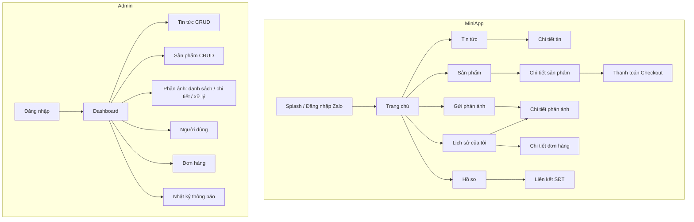

# DESIGN – Zalo Mini App Starter Kit

> Vai trò: UI/UX Designer · Nguyên tắc: **mobile-first, tiếng Việt, gần gũi ngôn ngữ thiết kế Zalo**, dễ đổi thương hiệu.

## 1. Design system

### 1.1 Màu (design tokens – đổi 1 chỗ là đổi toàn app)
Khai báo tại `miniapp/src/theme/tokens.css` và `admin/src/index.css` dưới dạng CSS variables, Tailwind đọc qua `tailwind.config`.

| Token | Giá trị | Dùng cho |
|-------|---------|----------|
| `--color-primary` | `#0068FF` | Nút chính, link, header (xanh Zalo) |
| `--color-primary-dark` | `#0052CC` | Hover / pressed |
| `--color-primary-soft` | `#E8F1FF` | Nền chip, nền icon |
| `--color-success` | `#12B76A` | Trạng thái Đã xử lý / Đã thanh toán |
| `--color-warning` | `#F79009` | Đang xử lý / Chờ thanh toán |
| `--color-danger` | `#F04438` | Lỗi, Từ chối |
| `--color-text` | `#101828` | Văn bản chính |
| `--color-text-muted` | `#667085` | Văn bản phụ |
| `--color-border` | `#EAECF0` | Viền, divider |
| `--color-bg` | `#F4F5F7` | Nền trang |
| `--color-surface` | `#FFFFFF` | Card |

Tương phản văn bản chính trên nền trắng ≥ 4.5:1 (WCAG AA).

### 1.2 Typography
- Font: **Inter** (hỗ trợ tiếng Việt đầy đủ), fallback `-apple-system, Roboto, "Segoe UI", sans-serif`. Trên Zalo dùng font hệ thống để tải nhanh.
- Thang chữ: `xs 12/16`, `sm 14/20`, `base 16/24` (mặc định thân bài), `lg 18/28`, `xl 20/28` (tiêu đề màn), `2xl 24/32` (số liệu dashboard).
- Đậm: 400 thân bài, 500 nhãn, 600 tiêu đề.

### 1.3 Spacing, bo góc, đổ bóng
- Lưới 4px: `4, 8, 12, 16, 20, 24, 32`. Lề màn hình mobile **16px**.
- Bo góc: `8px` input/nút, `12px` card, `9999px` chip/avatar.
- Bóng: `0 1px 2px rgba(16,24,40,.06)` card; `0 8px 24px rgba(16,24,40,.12)` sheet/modal.
- Vùng chạm tối thiểu **44×44px**.

### 1.4 Component
| Component | Mô tả |
|-----------|-------|
| `Button` | primary / secondary / ghost / danger; trạng thái loading (spinner + disable) |
| `Card` | nền trắng, bo 12, padding 16 |
| `StatusBadge` | màu theo trạng thái phản ánh/đơn hàng |
| `ListItem` | thumbnail 64×64 + tiêu đề 2 dòng + meta |
| `Skeleton` | khung xám nhấp nháy cho loading |
| `EmptyState` | icon + tiêu đề + mô tả + CTA |
| `ErrorState` | icon cảnh báo + thông điệp + "Thử lại" |
| `PermissionPrompt` | giải thích vì sao cần quyền + nút "Cho phép" / "Để sau" |
| `ImagePicker` | lưới 3 cột, ô "+", xem trước, xoá ảnh, đếm `2/5` |
| `BottomNav` | 4 tab: Trang chủ · Khám phá · Lịch sử · Hồ sơ |
| `MockPanel` | nút nổi "MOCK" mở bảng chỉnh: user giả, từ chối quyền, lỗi mạng giả |
| Admin: `DataTable`, `Pagination`, `FormField`, `ConfirmDialog`, `Sidebar` | |

Trên Mini App ưu tiên dùng component của **zmp-ui** (`Page`, `Header`, `BottomNavigation`, `Sheet`, `Input`, `Select`, `Button`, `useSnackbar`) để đúng trải nghiệm Zalo; Tailwind dùng cho layout & tinh chỉnh.

## 2. Sitemap

## 3. Mô tả màn hình – Mini App

| Màn | Nội dung | Trạng thái đặc biệt |
|-----|----------|---------------------|
| **Splash/Đăng nhập** | Logo, tên app, spinner "Đang đăng nhập bằng Zalo…" | Lỗi: thông điệp + "Thử lại" |
| **Trang chủ** | Header xanh: "Xin chào, {tên}" + avatar; banner giới thiệu; lưới 4 lối tắt (icon tròn nền `primary-soft`); "Tin mới" (3 item); "Sản phẩm nổi bật" (lưới 2 cột) | Skeleton cho từng khối; lỗi từng khối độc lập |
| **Tin tức** | Thanh tìm kiếm, chip chuyên mục cuộn ngang, danh sách `ListItem`, nút "Xem thêm" | Rỗng: "Chưa có tin nào" |
| **Chi tiết tin** | Ảnh bìa 16:9, chip chuyên mục, tiêu đề, ngày, nội dung | 404 → ErrorState |
| **Sản phẩm** | Lưới 2 cột: ảnh vuông, tên 2 dòng, giá màu primary | |
| **Chi tiết sản phẩm** | Ảnh, tên, giá, mô tả, chọn số lượng, nút cố định đáy "Mua ngay – {tổng}" | Đang thanh toán: nút loading; kết quả: Sheet thành công/thất bại |
| **Gửi phản ánh** | Select chuyên mục, input tiêu đề, textarea nội dung, ImagePicker, khối Vị trí (nút "Lấy vị trí hiện tại" / ô địa chỉ), nút "Gửi phản ánh" | Lỗi validate dưới từng field; từ chối vị trí → banner vàng hướng dẫn |
| **Chi tiết phản ánh** | Mã, badge trạng thái, timeline (Đã gửi → Đang xử lý → Kết quả), ảnh, phản hồi của cán bộ | |
| **Lịch sử** | Tab "Phản ánh" / "Đơn hàng", danh sách có badge | Rỗng có CTA "Gửi phản ánh đầu tiên" |
| **Hồ sơ** | Avatar, tên (sửa được), SĐT (hoặc nút "Liên kết số điện thoại"), vị trí gần nhất, phiên bản app, chế độ (Mock/Real), "Đăng xuất" | Từ chối SĐT → PermissionPrompt |

## 4. Mô tả màn hình – Admin (desktop-first nhưng responsive)
- **Layout**: sidebar trái 240px (thu gọn thành drawer trên mobile), topbar có tên + vai trò + Đăng xuất.
- **Đăng nhập**: card giữa màn, email + mật khẩu, gợi ý tài khoản demo.
- **Dashboard**: 4 thẻ số liệu (Người dùng, Phản ánh mới, Đơn đã thanh toán, Doanh thu), bảng 5 phản ánh mới nhất.
- **Tin tức / Sản phẩm**: bảng (tìm kiếm, phân trang), nút "Thêm mới" mở form trang riêng; trường ảnh nhập URL hoặc upload.
- **Phản ánh**: bảng lọc trạng thái; trang chi tiết gồm thông tin người gửi, nội dung, ảnh (lightbox), bản đồ link Google Maps, form "Cập nhật trạng thái + phản hồi".
- **Người dùng / Đơn hàng / Nhật ký thông báo**: bảng chỉ đọc.

## 5. Nguyên tắc UX
1. **Xin quyền đúng lúc** (contextual): chỉ xin SĐT/vị trí khi người dùng bấm vào chức năng cần nó, luôn giải thích trước.
2. Mọi thao tác mạng có phản hồi trong 100ms (spinner/skeleton), lỗi luôn có đường thoát ("Thử lại").
3. Văn phong: lịch sự, ngắn, xưng "bạn".
