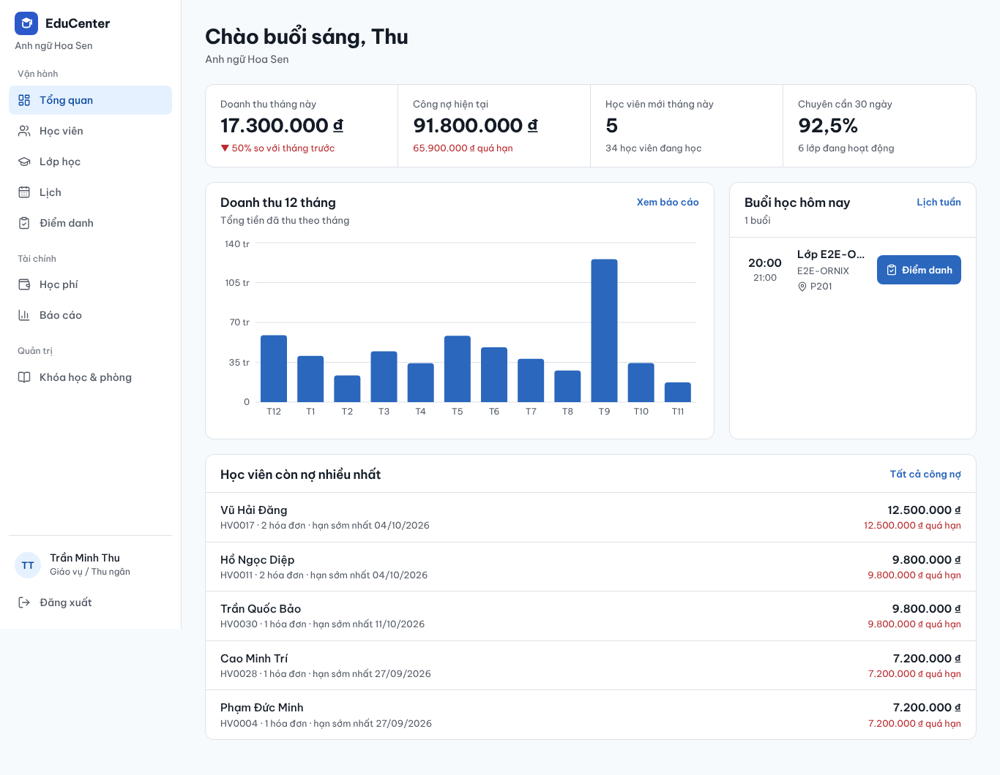
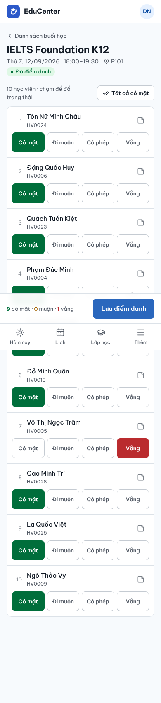
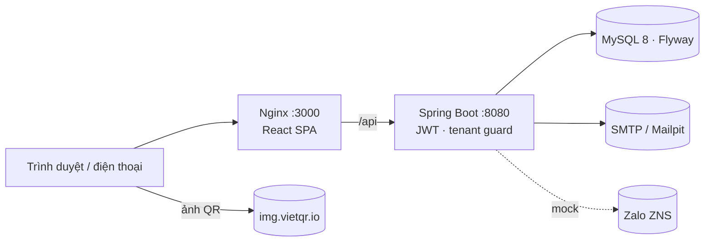
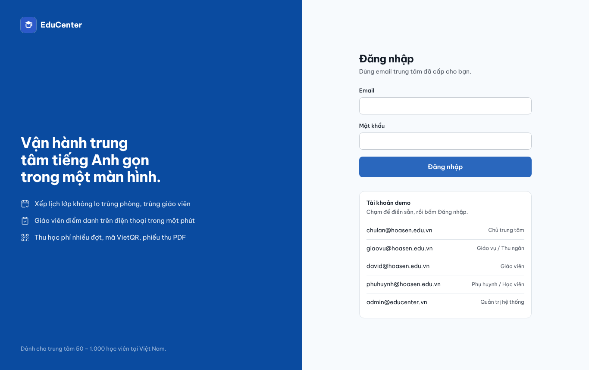
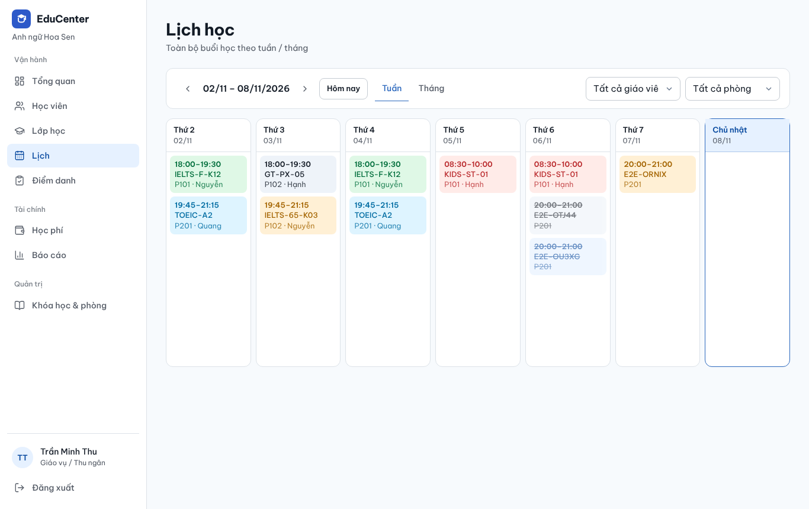
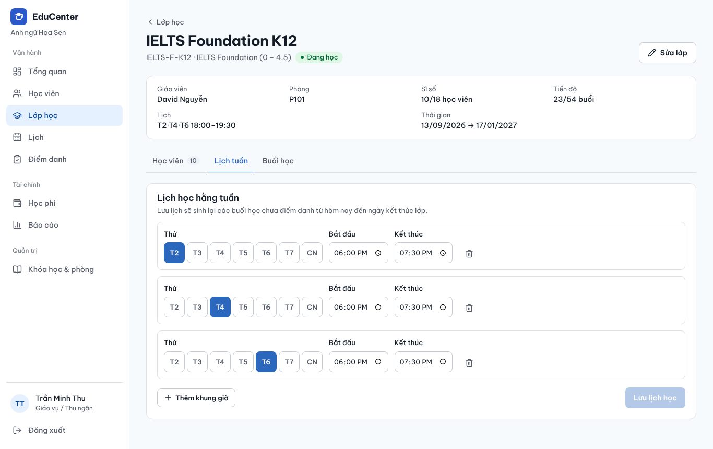
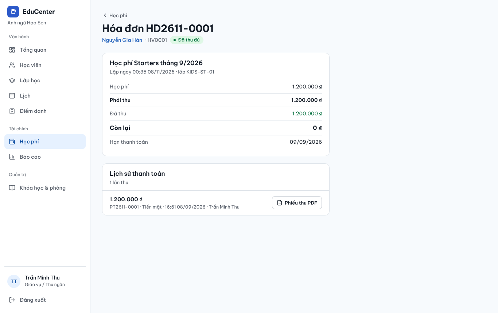
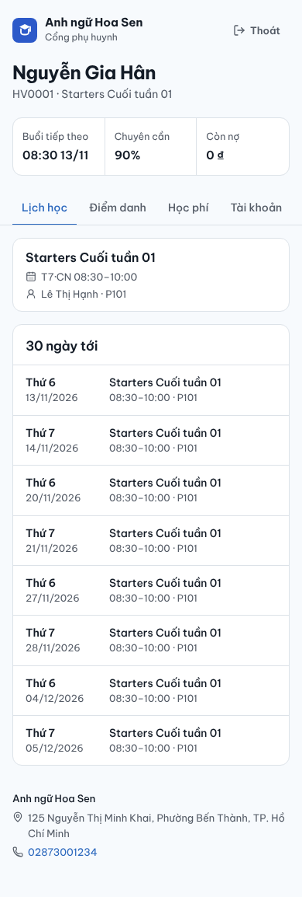

# EduCenter – Phần mềm quản lý trung tâm tiếng Anh (SaaS)

EduCenter giúp trung tâm tiếng Anh nhỏ và vừa ở Việt Nam quản lý **học viên – lớp – lịch – điểm danh – học phí – nhắc nhở – báo cáo** trên một hệ thống, dùng tốt trên điện thoại. Mỗi trung tâm là một *tenant*, dữ liệu tách biệt hoàn toàn. Bán theo gói tháng (SaaS) hoặc cài đặt riêng (bán đứt).

<p>
  
  
</p>

## Tính năng (MVP)

| Nhóm | Có gì |
| --- | --- |
| **Đa trung tâm & phân quyền** | 5 vai trò: Quản trị hệ thống, Chủ trung tâm, Giáo vụ/Thu ngân, Giáo viên, Phụ huynh/Học viên. JWT access + refresh (xoay vòng, phát hiện token bị dùng lại). Khóa trung tâm/tài khoản. |
| **Học viên** | Hồ sơ, nhiều phụ huynh (liên hệ chính), trạng thái *Đang học / Học thử / Bảo lưu / Đã nghỉ*, lịch sử lớp, chuyên cần, học phí, cấp tài khoản cổng. Mã HV tự sinh. |
| **Khóa học, lớp, phòng** | Lớp có giáo viên, phòng, sĩ số tối đa, ngày bắt đầu/kết thúc; **lịch lặp theo tuần**, tự sinh buổi học. Ghi danh kiểm tra sĩ số và trùng lặp. |
| **Lịch** | Xem tuần/tháng, lọc giáo viên/phòng; **kiểm tra trùng phòng & trùng giáo viên** ngay khi chọn giờ; hủy/đổi giờ từng buổi. |
| **Điểm danh** | Giáo viên chạm 1 lần/học viên trên điện thoại (Có mặt · Đi muộn · Có phép · Vắng), ghi chú; thống kê chuyên cần theo lớp và học viên. |
| **Học phí & công nợ** | Gói học phí, hóa đơn (giảm giá, hạn), **thu nhiều lần**, quá hạn tự tính, công nợ theo học viên, **mã VietQR** (img.vietqr.io) đúng số còn lại, **phiếu thu PDF** tiếng Việt có số tiền bằng chữ. |
| **Nhắc nhở** | Email nhắc lịch học (19:00 cho buổi ngày mai) và học phí (08:00, sắp hạn ≤ 3 ngày/quá hạn), chống gửi trùng; **Zalo ZNS** có interface + bản mock; nhật ký gửi; nút "Gửi ngay". |
| **Báo cáo** | Dashboard doanh thu tháng, công nợ, học viên mới, chuyên cần 30 ngày; biểu đồ 12 tháng; **xuất Excel** doanh thu, công nợ, chuyên cần. |
| **Cổng phụ huynh** | Lịch 30 ngày tới, lịch sử điểm danh, hóa đơn + QR chuyển khoản, đổi mật khẩu. |

Tài liệu dự án: [PRD](docs/PRD.md) · [Thiết kế](docs/DESIGN.md) · [Kiến trúc & API](docs/ARCHITECTURE.md) · [Quyết định](docs/DECISIONS.md) · [Kế hoạch test](docs/TEST_PLAN.md) · [Checklist](docs/CHECKLIST.md) · [Báo cáo cuối](docs/FINAL_REPORT.md)

## Kiến trúc



- **Backend**: Java 21, Spring Boot 3.5, Spring Security + JWT (jjwt), JPA/Hibernate, MySQL 8, Flyway, MapStruct, Lombok, springdoc-openapi, OpenPDF, Apache POI, Spring Mail + `@Scheduled`.
- **Frontend**: React 19, Vite, TypeScript, Tailwind CSS 4, React Query, React Router, React Hook Form + Zod, Recharts, lucide-react. Font *Be Vietnam Pro*, giao diện mobile-first.
- **Multi-tenant**: chung schema, cột `tenant_id` ở mọi bảng nghiệp vụ; tenant lấy từ JWT, mọi truy vấn repository đều lọc `tenantId` (có integration test chứng minh không rò rỉ chéo).

## Chạy nhanh bằng Docker (1 lệnh)

Yêu cầu: Docker 24+ với Compose v2.

```bash
cd educenter
```

```bash
cp .env.example .env
```

```bash
docker compose up -d --build
```

| Dịch vụ | Địa chỉ |
| --- | --- |
| Ứng dụng web | http://localhost:3000 |
| API + Swagger UI | http://localhost:8080/swagger-ui.html |
| Hộp thư test (Mailpit) | http://localhost:8025 |

Lần đầu khởi động, dữ liệu demo tiếng Việt được tạo tự động (`APP_SEED_DEMO=true`, chỉ khi database trống).

### Tài khoản demo

| Vai trò | Email | Mật khẩu |
| --- | --- | --- |
| Chủ trung tâm (Anh ngữ Hoa Sen) | `chulan@hoasen.edu.vn` | `Demo@123` |
| Giáo vụ / Thu ngân | `giaovu@hoasen.edu.vn` | `Demo@123` |
| Giáo viên | `david@hoasen.edu.vn` (hoặc `hanh@`, `quang@`) | `Demo@123` |
| Phụ huynh (bé Nguyễn Gia Hân) | `phuhuynh@hoasen.edu.vn` | `Demo@123` |
| Quản trị hệ thống | `admin@educenter.vn` | `Admin@123` |
| Chủ trung tâm thứ 2 (kiểm tra tách dữ liệu) | `chu@saomai.edu.vn` | `Demo@123` |

Dữ liệu demo gồm 2 trung tâm, 36 học viên, 7 lớp (IELTS, TOEIC, thiếu nhi, giao tiếp), lịch học và điểm danh từ ngày khai giảng, hóa đơn 12 tháng (đã thu, thu một phần, quá hạn).

## Chạy để phát triển

Cần Java 21, Maven 3.9, Node 22, MySQL 8 (hoặc chỉ chạy MySQL bằng Docker).

```bash
docker run -d --name edu-mysql -p 3306:3306 -e MYSQL_DATABASE=educenter -e MYSQL_USER=educenter -e MYSQL_PASSWORD=educenter -e MYSQL_ROOT_PASSWORD=root mysql:8.4 --character-set-server=utf8mb4 --collation-server=utf8mb4_unicode_ci
```

```bash
cd educenter/backend && APP_SEED_DEMO=true MAIL_ENABLED=false mvn spring-boot:run
```

```bash
cd educenter/frontend && npm install && npm run dev
```

Mở http://localhost:5173 (Vite proxy `/api` sang `localhost:8080`).

## Kiểm thử

```bash
cd educenter/backend && mvn verify
```

```bash
cd educenter/frontend && npm run typecheck && npm test
```

```bash
cd educenter/e2e && npm install && npx playwright install chromium && BASE_URL=http://localhost:3000 npx playwright test
```

- Backend: 21 unit test + 10 integration test trên MySQL thật (Testcontainers, cần Docker).
- Frontend: 12 unit test (Vitest). E2E: 5 kịch bản Playwright (desktop + mobile).
- GitHub Actions (`.github/workflows/educenter-ci.yml`) chạy cả ba ở mỗi push/PR.

## Ảnh màn hình

| | |
| --- | --- |
|  |  |
|  |  |



## Cấu hình chính (biến môi trường)

| Biến | Ý nghĩa | Mặc định |
| --- | --- | --- |
| `DB_URL`, `DB_USERNAME`, `DB_PASSWORD` | Kết nối MySQL | localhost / educenter |
| `JWT_SECRET` | Khóa ký JWT, **≥ 32 ký tự ngẫu nhiên**; app từ chối chạy ở profile `prod` nếu dùng giá trị mặc định | giá trị dev |
| `JWT_ACCESS_TTL_MINUTES`, `JWT_REFRESH_TTL_DAYS` | Thời hạn token | 15 phút / 7 ngày |
| `APP_SEED_DEMO` | Tạo dữ liệu demo khi DB trống | `false` (compose: `true`) |
| `APP_CORS_ORIGINS` | Origin được gọi API trực tiếp | localhost |
| `MAIL_HOST`, `MAIL_PORT`, `MAIL_USERNAME`, `MAIL_PASSWORD`, `MAIL_SMTP_AUTH`, `MAIL_STARTTLS`, `MAIL_FROM` | SMTP gửi nhắc nhở | Mailpit |
| `REMINDER_SESSION_CRON`, `REMINDER_FEE_CRON` | Giờ chạy nhắc (giờ Việt Nam) | `0 0 19 * * *`, `0 0 8 * * *` |
| `ZALO_MODE` | `mock` (ghi log) | `mock` |
| `SPRINGDOC_ENABLED` | Bật Swagger UI | `true` (tắt ở profile `prod`) |

## Triển khai lên máy chủ (VPS 2 GB RAM)

1. Cài Docker, clone repo, `cd educenter`, tạo `.env` từ `.env.example`: đổi `JWT_SECRET` (`openssl rand -base64 48`), mật khẩu DB, `APP_SEED_DEMO=false`, SMTP thật (VD: Gmail App Password, Amazon SES, Mailgun), `APP_CORS_ORIGINS=https://ten-mien-cua-ban`.
2. Thêm `SPRING_PROFILES_ACTIVE=prod` cho service `backend` (tắt Swagger, bắt buộc secret mạnh).
3. `docker compose up -d --build`, đặt reverse proxy có HTTPS (Caddy/Nginx + Let's Encrypt) trỏ vào cổng 3000.
4. Sao lưu: `docker compose exec mysql mysqldump -u root -p educenter > backup.sql` theo lịch (cron) và lưu ra ngoài máy chủ.
5. Tạo trung tâm cho khách: đăng nhập tài khoản quản trị hệ thống → *Trung tâm* → *Tạo trung tâm* (kèm tài khoản chủ). Tạo tài khoản quản trị hệ thống đầu tiên bằng cách bật seed một lần trên môi trường thử, hoặc chèn bản ghi `users` với `role='SUPER_ADMIN'` và mật khẩu BCrypt.

## Tích hợp Zalo ZNS thật

Hiện `MockZaloZnsClient` chỉ ghi log và lưu `notification_logs` với trạng thái `MOCK`. Để gửi thật:

1. Có **Zalo Official Account đã xác thực** (doanh nghiệp), tạo ứng dụng tại *Zalo for Developers* và liên kết OA.
2. Đăng ký **template ZNS** (nhắc lịch học, nhắc học phí) với các tham số `student_name`, `class_name`, `date`, `time`, `invoice_code`, `amount`, `due_date`; chờ Zalo duyệt để có `template_id`.
3. Lấy **OA access token** qua OAuth v4 và lưu refresh token (hết hạn sau ~3 tháng) – cần job làm mới token.
4. Viết lớp `HttpZaloZnsClient implements ZaloZnsClient` gọi `POST https://business.openapi.zalo.me/message/template` với header `access_token`, body `{"phone":"84xxxxxxxxx","template_id":"...","template_data":{...},"tracking_id":"..."}` (đổi số `0xxx` → `84xxx`), đánh dấu `@ConditionalOnProperty(app.zalo.mode=real)`; ánh xạ template ở `ReminderService` (`SESSION_REMINDER_TEMPLATE`, `FEE_REMINDER_TEMPLATE`).
5. Đặt `ZALO_MODE=real`. Chi phí ZNS tính theo tin (~200–300 ₫/tin tùy loại).

## Cấu trúc thư mục

```
educenter/
├── backend/            Spring Boot (vn.educenter.{auth,tenant,user,student,catalog,classes,attendance,billing,notification,report,portal,seed})
├── frontend/           React SPA (src/{api,components,layouts,lib,pages})
├── e2e/                Playwright
├── docs/               PRD, DESIGN, ARCHITECTURE, DECISIONS, CHECKLIST, TEST_PLAN, FINAL_REPORT, screenshots
├── docker-compose.yml
└── .env.example
```

## Nguồn gốc

Viết lại từ dự án `english-class-manager` (Next.js + Supabase, một giáo viên) sang kiến trúc SaaS đa trung tâm; giữ nghiệp vụ, logic học phí/VietQR và bản sắc giao diện. Xem [DECISIONS.md](docs/DECISIONS.md).
